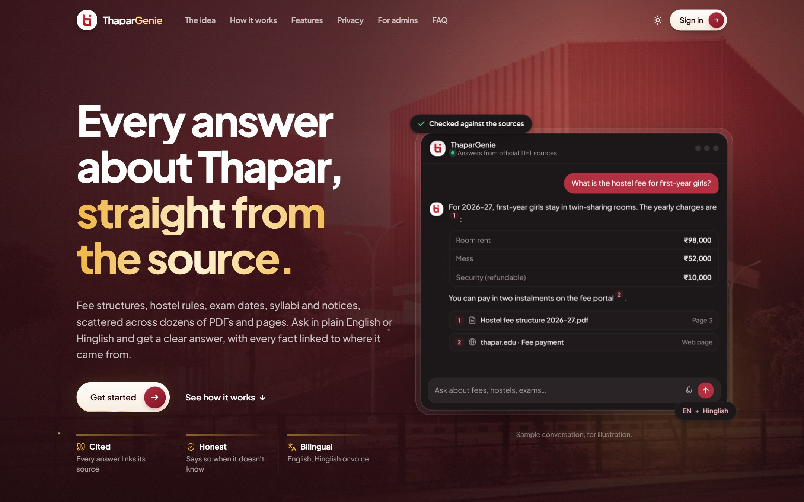
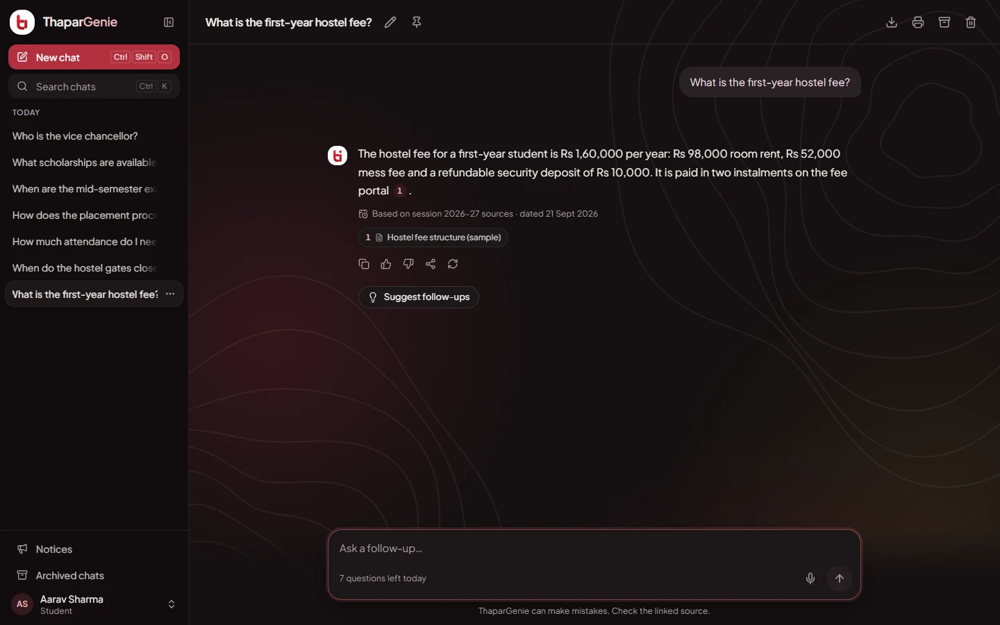
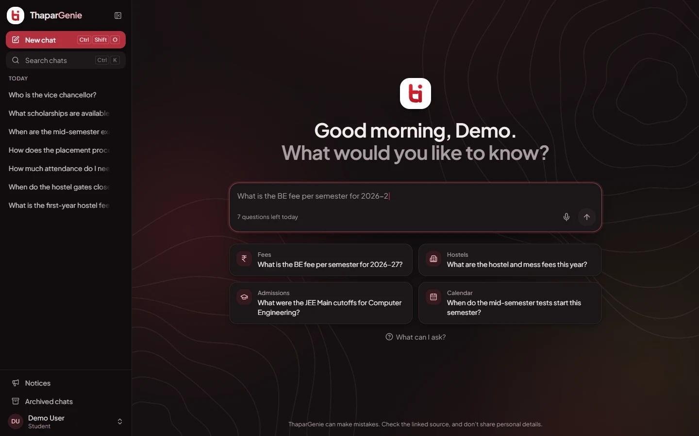
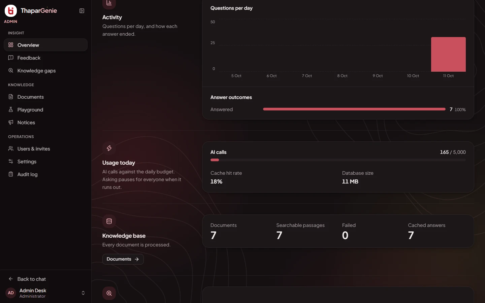
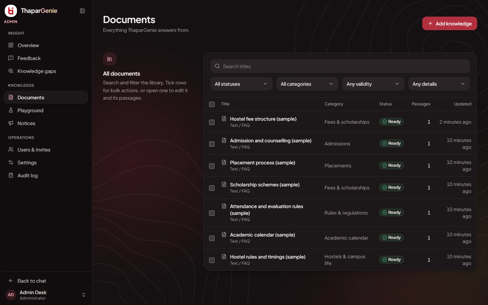
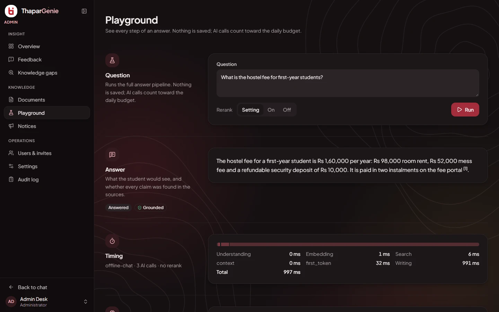
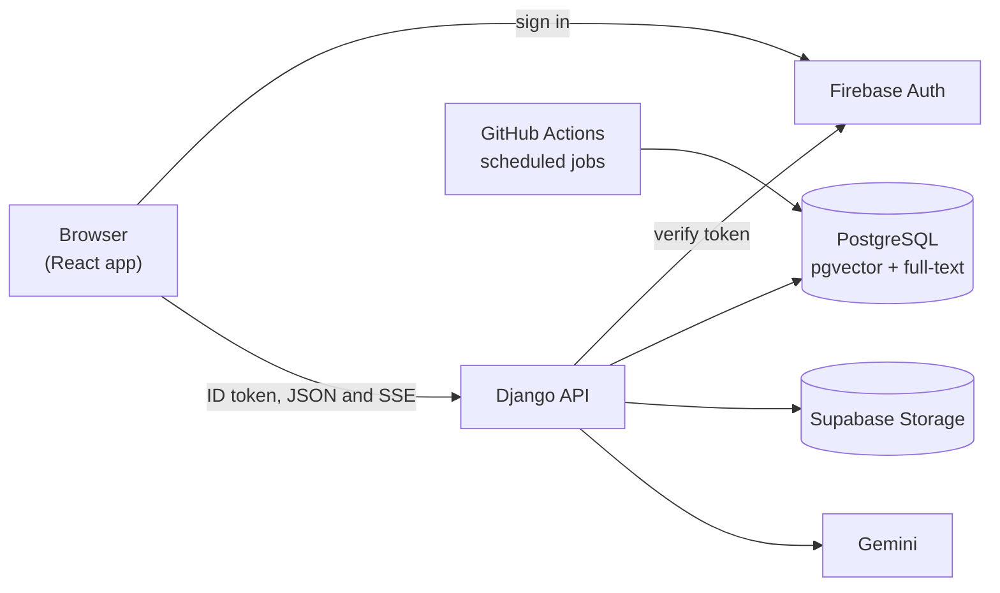
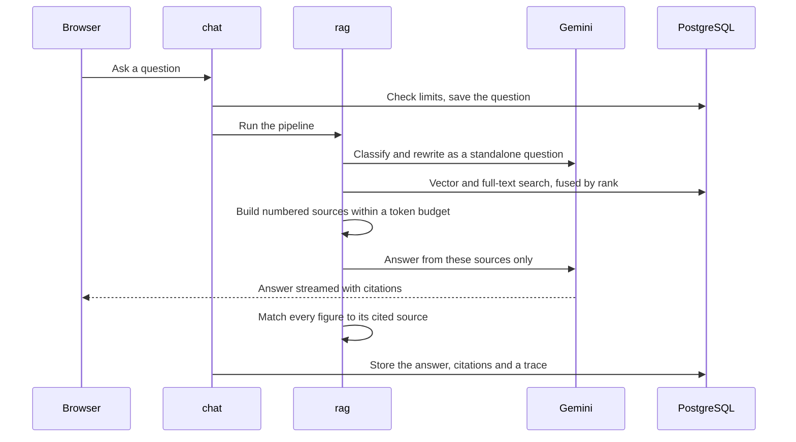

<p align="center">
  <a href="https://thapargenie.divyanshuagrahari.dev"></a>
</p>

<p align="center">
  <b>Every answer about Thapar, straight from the source.</b><br/>
  A campus assistant that answers from official TIET documents and links every fact to its source.
</p>

<p align="center">
  <a href="https://github.com/Divyanshu2805/thapargenie/actions/workflows/ci.yml"></a>
  
  
  
  
  
  
  
  
  
  
  
  <a href="LICENSE"></a>
</p>

---

Students at Thapar Institute of Engineering and Technology (TIET) look for fees, hostel rules, cutoffs, calendars and syllabi across dozens of pages and PDFs. **ThaparGenie** answers the question directly, from the official documents, with a numbered link to every source it used, and says so plainly when the documents don't cover it.

Every figure in an answer is checked against the sources it cites before the answer is stored. Admins run the knowledge base from a separate dashboard: they upload documents, review feedback, see which questions went unanswered and post notices.

## Try it

| | |
|---|---|
| **App** | [thapargenie.divyanshuagrahari.dev](https://thapargenie.divyanshuagrahari.dev) |
| **Demo login** | `demo@thapargenie.dev` / `demo1234` |

The demo account already has a few questions asked, so you land straight in a chat with cited answers. It's shared and resets every day, so it can't change its profile or sign others out. Register with an email to get your own account. New accounts are verified by email and approved by an admin. The API sleeps when idle, so the first request after a quiet spell takes up to a minute.

<p align="center">
  
</p>

## Features

**Asking**
- Questions in English or Hinglish, with follow-ups understood from the chat.
- Streamed answers with a citation on every fact. Each one opens the official page or file.
- Every figure (amounts, years, dates) is matched against the sources it cites, and the answer is flagged when one isn't found.
- A line saying which academic session the sources cover, with a warning when they are out of date.
- A clear "I couldn't find this" with where to look, instead of a guess.
- "List all" questions read the whole page, so no item is left out.
- Follow-up suggestions, voice input and starter questions.

**Conversations**
- History across devices with search, pin, archive and rename.
- Branches: regenerate an answer or edit a question and flip between versions.
- Download as Markdown, print, or share one answer as a public link for 7 days.
- Notices from admins, a "What can I ask?" page, light and dark themes, and install as an app.

**Admin dashboard**
- Documents: upload PDF, Word, Excel, CSV, HTML or text, add a web page by URL, edit details, act on 100 at once, and view or edit single passages.
- Insight: usage, answer outcomes, latency, AI spend against a daily budget, feedback review, unanswered questions, and a nightly search-quality score with regression warnings.
- A playground that shows how any question was analysed, searched and answered, with the time each step took.
- Users and invitations, notices, runtime settings, CSV exports and an audit log.
- Two-factor sign-in for staff.

## Screenshots

| | |
|---|---|
|  |  |
| Starter questions and history | Admin overview |
|  |  |
| Documents | Playground |

Screenshots are from a local stack with sample documents.

## Results

| | |
|---|---|
| Search quality | recall@5 of **0.94 to 1.00** and MRR of 0.91 to 1.00 across four scored runs on the production knowledge base, re-scored every night |
| Capacity | **400 students** at once on half a CPU with no failed requests, across a load test of 102,194 requests |
| Speed | A full streamed answer in **10.2 s** at the median; a repeated question is served from the cache at once |
| Accessibility | Lighthouse **100** on every page measured |
| First screen | 218 kB of gzipped JavaScript; every later page loads on demand |

Every figure and how to re-check it is in [project metrics](docs/metrics.md) and [load testing](docs/load-testing.md).

## How it works



| App | Owns |
|---|---|
| `chat` | Conversations as a message tree, the streaming chat API, quotas, the answer cache, sharing, feedback |
| `rag` | Model clients, question analysis, hybrid search, source building, the answer pipeline, the grounding check, evaluation |
| `knowledge` | Documents and passages, file storage, the ingestion pipeline |
| `access` | Users, invitations, the audit log, staff two-factor |
| `api`, `userauths` | Firebase token checks, identity mapping, the user model and profile |
| `notices` | Announcements |

Everything durable lives in one PostgreSQL database, and search runs there too, so there is no separate vector store, queue or cache server. Identity comes from a verified Firebase ID token on every request, a student reaches only their own chats, and the model never receives who is asking.

Each question goes like this:



A greeting, a personal-record request or an off-topic question gets a fixed reply and never reaches search. The first question of a chat can be answered from a semantic cache.

More detail in [architecture](docs/architecture/README.md), [asking a question](docs/architecture/flows/asking-a-question.md) and the [security model](docs/architecture/security-model.md).

## Stack

| | |
|---|---|
| API | Python 3.13, Django 5.2, Django REST Framework, gunicorn |
| Data | PostgreSQL 17 with pgvector (`halfvec(768)`, HNSW) and full-text search |
| Models | Google Gemini for analysis, answers and embeddings, with an OpenAI adapter behind the same interface |
| Web app | React 19, Vite 8, Tailwind CSS 4, Radix UI, TanStack Query, React Router |
| Services | Firebase Authentication and Hosting, Supabase, Render, Sentry |
| Testing | pytest, Vitest, Playwright, ruff, ESLint, Locust, GitHub Actions |

Versions and what each piece is for are in the [tech stack](docs/tech-stack.md).

## Running locally

You need Python 3.13, Node 24, Docker, a Firebase project and a Gemini API key.

```bash
git clone https://github.com/Divyanshu2805/thapargenie.git
cd thapargenie
docker compose up -d db                       # PostgreSQL with pgvector

python -m venv Backend/.venv
source Backend/.venv/bin/activate             # Windows: Backend\.venv\Scripts\activate
pip install -r Backend/requirements-dev.txt
cp Backend/backend/.env.example Backend/backend/.env
cd Backend/backend
python manage.py migrate
python manage.py createcachetable
python manage.py runserver

# in another terminal
cd Frontend
cp .env.example .env.local                    # Firebase web config and the API URL
npm ci
npm run dev
```

The app is on http://localhost:5173 and the API on http://127.0.0.1:8000. Two commands help when working on answers:

```bash
python manage.py ask "question" --trace       # one question through the pipeline, step by step
python manage.py eval_rag                     # score search quality
```

Approving your account, becoming an admin, adding a knowledge base and running with no Gemini key are covered in [local development](docs/local-development/README.md).

## Testing and CI

| Suite | |
|---|---|
| Backend | 595 tests (pytest), 92% statement coverage of the answer, chat and knowledge code, with an 80% floor |
| Frontend | 246 tests (Vitest) |
| Browser | 5 Playwright journeys against the whole stack under the Auth emulator |
| Search quality | 23 fixed questions scored every night against the production knowledge base |

Every push and pull request runs a secret scan, lint, all three suites with the coverage floor, migration and OpenAPI checks, a dependency audit and a build. Work merges into `dev`, and a release is one pull request from `dev` into `main`. Once CI passes there, the web app deploys to Firebase Hosting and the API to Render. GitHub Actions also runs the scheduled jobs: the nightly search-quality score, a daily purge of expired data, a weekly encrypted backup and a weekly re-read of web pages. See [deployment](docs/deployment/README.md).

## Repository layout

```
Backend/backend/
  backend/          settings per environment, URL root, gunicorn entry
  userauths/        users, profiles, invitations
  api/              Firebase token checks, identity mapping, /me, health, audit events
  common/           throttles, event streams, safe URL fetching, logging
  knowledge/        documents and passages, storage, the ingestion pipeline
  rag/              model clients, analysis, hybrid search, the answer pipeline, evaluation
  chat/             conversations, the streaming chat API, quotas, cache, admin statistics
  access/           user and invitation management, staff two-factor
  notices/          announcements
Frontend/
  src/features/     one folder per feature: chat, admin, landing, notices, settings, ...
  src/lib/          request wrapper, stream reader, API calls
  e2e/              Playwright journeys
loadtest/           the load-test stack and its scripts
docs/               documentation
.github/workflows/  CI, the frontend deploy, scheduled jobs
```

## Docs

| | |
|---|---|
| [Features](docs/features.md) | Everything the app does, by area |
| [Architecture](docs/architecture/README.md) | The parts, request flows, security model, decision records |
| [API](docs/api/README.md) | Every endpoint, the event stream, errors and rate limits |
| [Data model](docs/schema/README.md) | Tables, indexes, conventions, retention |
| [Local development](docs/local-development/README.md) | Setup, configuration, commands, troubleshooting |
| [Deployment](docs/deployment/README.md) · [Operations](docs/deployment/operations.md) | Production, releases, scheduled jobs, backups |
| [Metrics](docs/metrics.md) · [Load testing](docs/load-testing.md) | Every measurement and how it was taken |

## License

[MIT](LICENSE) · [Privacy Policy](https://thapargenie.divyanshuagrahari.dev/privacy)
